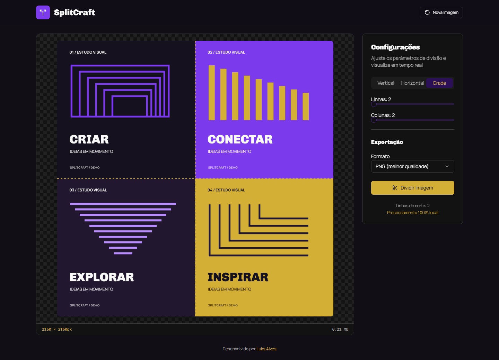
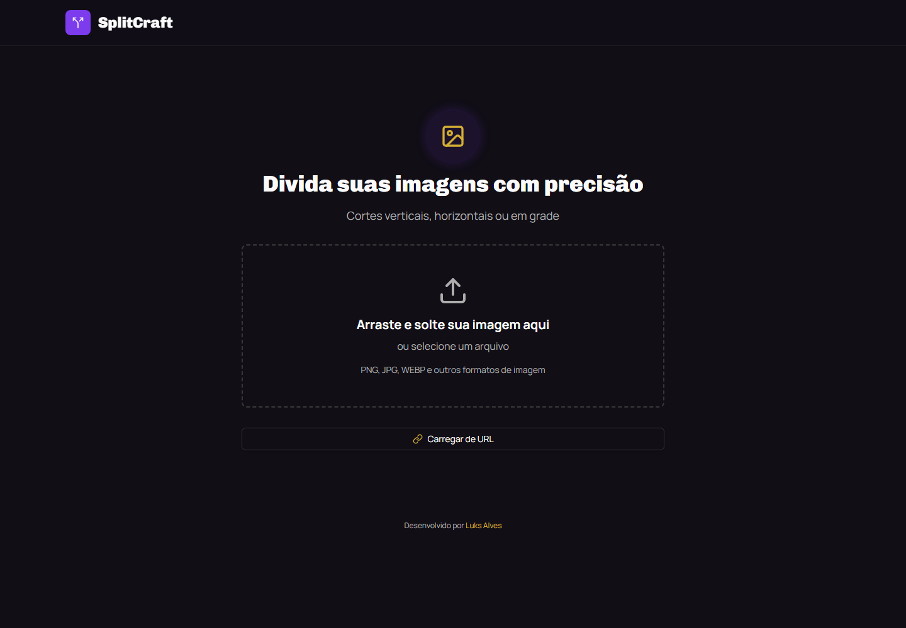
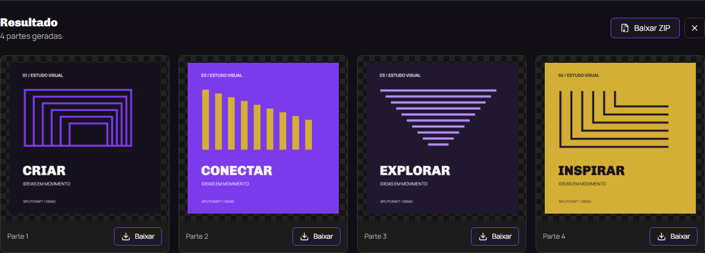
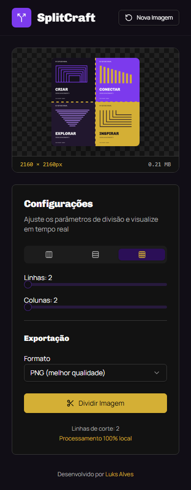

# SplitCraft

Divida imagens em partes verticais, horizontais ou em grade, com prévia dos cortes e processamento no navegador.

[](https://react.dev/)
[](https://vite.dev/)
[](LICENSE)

**[Acessar o SplitCraft](https://splitcraft.pages.dev/)** · [Capturas de tela](#capturas-de-tela) · [Executar localmente](#executar-localmente) · [Licença](#licença)



## Por que criei o SplitCraft

Trabalho com redes sociais e precisava cortar imagens com precisão para preparar publicações, carrosséis e mosaicos. Não queria depender de outro serviço de edição sempre que surgisse essa necessidade.

Criei o SplitCraft para ter uma ferramenta própria, simples e intuitiva: carregar a imagem, conferir os cortes e baixar as partes. O processamento acontece no navegador, sem enviar os arquivos locais para um backend do projeto.

## Funcionalidades

- **Importação por arquivo ou URL**, com seleção, arrastar e soltar, estado de carregamento e mensagens de erro.
- **Cortes verticais e horizontais**, por quantidade de partes ou medida fixa em pixels.
- **Divisão em grade**, com controle de linhas e colunas.
- **Prévia em tempo real**, com linhas de corte e informações da imagem fora da área de desenho.
- **Exportação em PNG, JPEG e WebP**, com ajuste de qualidade para JPEG e WebP e opção de manter o formato original quando suportado.
- **Download individual ou em ZIP**, com arquivos numerados.
- **Resultados em uma grade adaptável**, com rolagem automática até os recortes quando o processamento termina.
- **Interface responsiva**, com controles por teclado, foco nos resultados e respeito à preferência por movimento reduzido.

## Capturas de tela

Capturas reais da aplicação, com uma imagem de demonstração criada para este repositório. A arte usada no editor está disponível em [docs/assets/demo-social.png](docs/assets/demo-social.png), também sob a licença MIT.

<details>
<summary>Tela inicial no desktop</summary>



</details>

<details>
<summary>Resultados e downloads</summary>



</details>

<details>
<summary>Editor no celular</summary>

<p align="center">
  
</p>

</details>

## Como usar

1. Selecione uma imagem, arraste um arquivo para a área de upload ou informe uma URL.
2. Escolha o corte vertical, horizontal ou em grade.
3. Ajuste a quantidade de partes ou as medidas e confira as linhas na prévia.
4. Selecione o formato de exportação e clique em **Dividir Imagem**.
5. A página leva você até os resultados. Baixe cada parte ou use **Baixar ZIP**.

Para começar com a mesma arte das capturas, use a [imagem de demonstração](docs/assets/demo-social.png) com a grade de **2 linhas e 2 colunas**.

## Tecnologias

| Tecnologia            | Uso no projeto                                              |
| --------------------- | ----------------------------------------------------------- |
| React 18 e JavaScript | Componentes, estado da aplicação e fluxo de edição          |
| Vite 8                | Servidor de desenvolvimento e build estático                |
| Tailwind CSS 4        | Estilos responsivos e tema preto, roxo e dourado            |
| Radix UI              | Componentes de abas, seleção, sliders e botões de opção     |
| Canvas API            | Prévia da imagem, desenho das linhas e geração dos recortes |
| JSZip                 | Agrupamento dos arquivos em ZIP                             |
| Lucide React e Sonner | Ícones e notificações                                       |
| Vitest e JSDOM        | Testes unitários e de interface                             |
| ESLint e Prettier     | Análise de código e formatação                              |
| GitHub Actions        | Verificações automáticas do repositório                     |
| Cloudflare Pages      | Hospedagem da versão pública                                |

## Executar localmente

### Requisitos

- Node.js **22.13 ou superior na linha 22**, ou **Node.js 24**. A pasta `frontend` contém um arquivo `.nvmrc` para a linha 22.
- npm, incluído na instalação do Node.js.
- Um navegador moderno.

### Instalação

```sh
git clone https://github.com/xLuuks/splitcraft.git
cd splitcraft/frontend
npm ci
npm start
```

Abra [http://127.0.0.1:3000](http://127.0.0.1:3000). O comando `npm run dev` é equivalente a `npm start`.

Se a porta estiver ocupada:

```sh
npm start -- --port 3001
```

Nesse caso, acesse [http://127.0.0.1:3001](http://127.0.0.1:3001). Não é necessário configurar chaves de API, banco de dados ou backend.

## Testes e qualidade

Execute os comandos abaixo na pasta `frontend`:

```sh
npm run lint
npm run format:check
npm run test:ci
npm run build
```

Os testes cobrem cálculo e cobertura dos recortes, validação de parâmetros, formatos de exportação, cancelamento, liberação de URLs temporárias, carregamento de imagens, conteúdo do ZIP e navegação até os resultados.

| Comando                | Finalidade                                        |
| ---------------------- | ------------------------------------------------- |
| `npm test`             | Executar o Vitest em modo interativo              |
| `npm run test:ci`      | Executar toda a suíte uma vez                     |
| `npm run lint`         | Verificar o código e as regras de acessibilidade  |
| `npm run format:check` | Conferir a formatação                             |
| `npm run format`       | Aplicar a formatação                              |
| `npm audit`            | Consultar os avisos de segurança das dependências |

O [workflow do GitHub Actions](.github/workflows/ci.yml) está configurado para instalar as dependências, executar a auditoria, conferir lint e formatação, rodar os testes e gerar o build em pull requests e pushes para `main`.

Os testes de interface usam JSDOM. A revisão visual em navegadores reais complementa essas verificações.

## Build e deploy

```sh
cd frontend
npm run build
npm run preview
```

O build fica em **`frontend/build`**. O preview local do artefato gerado fica em [http://127.0.0.1:4173](http://127.0.0.1:4173).

Configuração esperada no Cloudflare Pages:

| Campo              | Valor                                           |
| ------------------ | ----------------------------------------------- |
| Branch de produção | `main`                                          |
| Diretório raiz     | `frontend`                                      |
| Comando de build   | `npm run build`                                 |
| Diretório de saída | `build`                                         |
| Versão do Node.js  | `NODE_VERSION=22`, com versão 22.13 ou superior |

O projeto é estático: apenas os arquivos do build precisam ser publicados. Consulte o [guia de deploy](docs/DEPLOYMENT.md) para conferir os detalhes e os valores do painel do Cloudflare.

## Estrutura e funcionamento

```text
splitcraft/
|-- .github/workflows/ci.yml
|-- docs/
|   |-- assets/
|   |-- screenshots/
|   |-- DEPLOYMENT.md
|   `-- MAINTENANCE.md
|-- frontend/
|   |-- public/favicon.svg
|   |-- src/
|   |   |-- components/
|   |   |   |-- ui/
|   |   |   |-- ImageUploader.jsx
|   |   |   |-- CanvasPreview.jsx
|   |   |   |-- ControlPanel.jsx
|   |   |   `-- ResultsGallery.jsx
|   |   |-- utils/
|   |   |   |-- imageLoader.js
|   |   |   |-- imageSplitter.js
|   |   |   |-- imageFormats.js
|   |   |   `-- downloadHelper.js
|   |   |-- App.jsx
|   |   `-- main.jsx
|   |-- index.html
|   |-- package.json
|   `-- vite.config.mjs
|-- LICENSE
`-- README.md
```

`App.jsx` coordena a imagem carregada, os parâmetros e os resultados. Os componentes cuidam de upload, prévia, controles e galeria; os utilitários concentram o carregamento, o cálculo dos cortes e a exportação.

A prévia e a exportação compartilham o cálculo das regiões em `imageSplitter.js`. Divisões não exatas preservam os pixels restantes na última parte de cada eixo. A geração dos recortes reutiliza um canvas e processa uma parte por vez para reduzir o pico de memória. URLs temporárias são liberadas ao substituir ou limpar os resultados e em falhas ou cancelamentos.

Mais informações em [docs/MAINTENANCE.md](docs/MAINTENANCE.md).

## Privacidade e limitações

O processamento dos arquivos locais acontece no navegador. Ao importar uma imagem por URL, o navegador faz uma requisição ao site de origem; o carregamento depende da conexão e da permissão CORS desse site. A aplicação também carrega fontes externas do Google Fonts.

- O desempenho e as dimensões máximas suportadas dependem da memória e dos limites de canvas do navegador.
- O motor limita cada operação a **400 partes**. A interface permite até **20 partes por quantidade** ou uma grade de até **10 × 10**; o valor mínimo de uma medida fixa é **10 px**.
- Arquivos animados são exportados como imagens estáticas, e os metadados do arquivo original não são preservados.
- A opção de manter o formato original usa PNG quando o tipo não possui codificador suportado. A extensão do download acompanha o formato efetivamente gerado pelo navegador.
- JPEG não preserva transparência. PNG ou WebP são opções para imagens com fundo transparente.

## Contribuições

Sugestões e relatos de problemas são bem-vindos nas [issues do repositório](https://github.com/xLuuks/splitcraft/issues). Para contribuir com código, crie uma branch, descreva a mudança no pull request e execute as verificações de qualidade. Alterações na interface devem incluir uma conferência em desktop e celular.

## Licença

Distribuído sob a [licença MIT](LICENSE).

Desenvolvido por **[Luks Alves](https://github.com/xLuuks)**.
